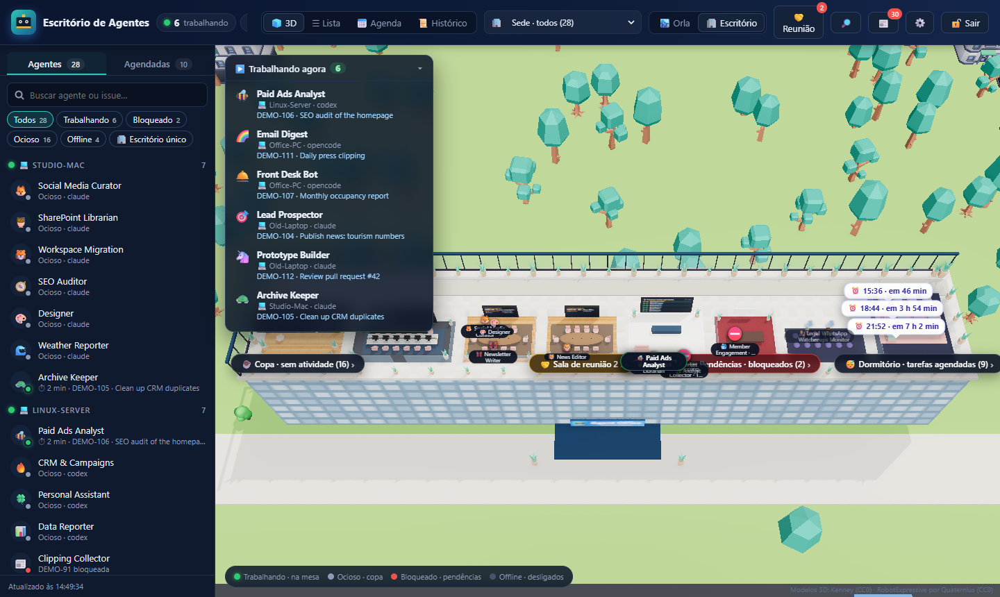
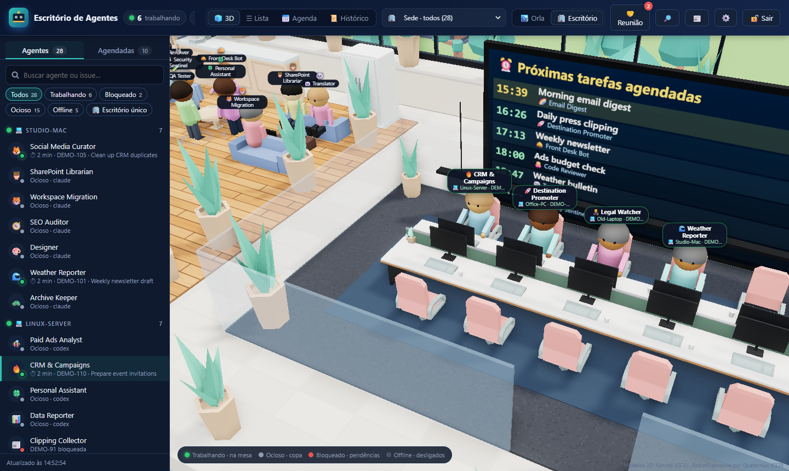
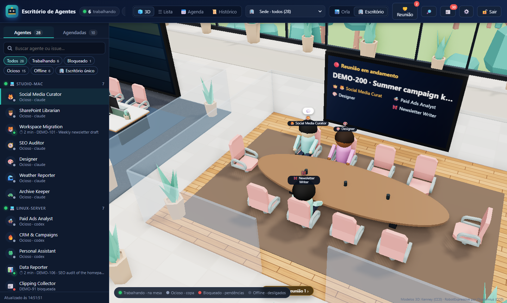
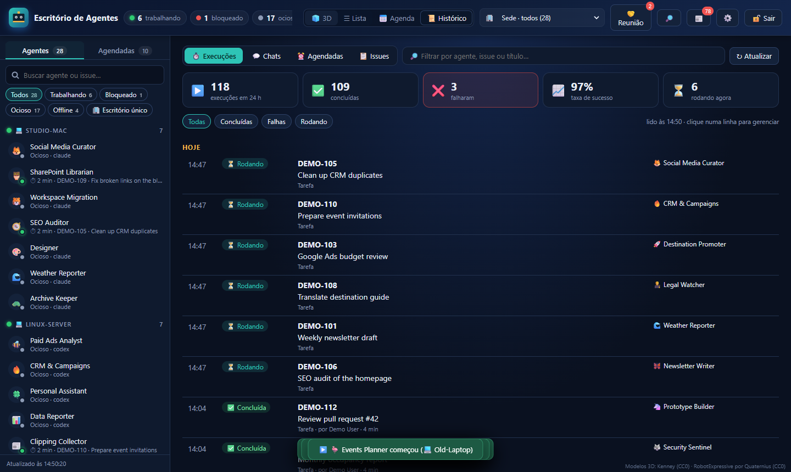

# Agent Office 3D

**A live 3D office for your AI agents.** Every agent in a [Multica](https://multica.ai) workspace becomes a person in a rooftop office on the Rio de Janeiro waterfront: agents walk from the lounge to a shared workstation when they start a task, greet their neighbours, meet in conference rooms, sleep in the dorm while scheduled tasks wait, and sit in the "pending" room when blocked. From the same screen you can start tasks, chat, call meetings, manage issues and read the full execution history.

🌐 **Website:** https://cspgabriel.github.io/agent-office-3d/



> 🇧🇷 [Leia em português](#português)

## Features

- **Live office** — status updates within ~2 s (lightweight poll + Server-Sent Events). Agents walk, sit, type, greet and talk; idle agents hang out in the lounge, blocked ones in the pending room, offline machines in a dark room.
- **Today at a glance** — how many runs each agent did today (ok / failed), shown on its label, in the list and in the top bar. Idle agents split into the ☕ lounge (haven't worked today) and the 🛋️ rest area (worked today, waiting for review), with the number of issues in review.
- **Shared workstations** — benches of 12 seats that fill side by side; each agent keeps its seat and greets neighbours on arrival.
- **Agent meetings** — pick agents (with automatic suggestions from the agenda text) and they all work on the same issue; each meeting gets its own room and wall screen.
- **Scheduled tasks** — wall screens with the next runs, a dorm with alarm clocks, agenda view, create/edit/trigger schedules.
- **History & management** — recent executions, scheduled runs, chats and every issue ordered by activity; open any issue to change status, priority, assignee, due date, comment (waking the agent), rerun, cancel runs, read each step, bulk status changes and full-text search.
- **Per-agent actions** — new task, conversation, chat history, edit instructions/model/skills, outfits (people or robots).
- **Themes** — 🌴 premium rooftop (default), 🏙️ classic waterfront, ⚪ minimal (lightweight).
- **One codebase, many installs** — each install points at a workspace, with its own brand name and logo; an updater pulls new versions on every server.
- **Demo mode** — try it without a Multica workspace.

| Shared workstation | Meeting room | History |
| --- | --- | --- |
|  |  |  |

## Quick start (demo, no Multica needed)

Requires Node.js 20+. No dependencies to install.

```bash
git clone https://github.com/cspgabriel/agent-office-3d
cd agent-office-3d
DEMO=1 npm start          # Windows PowerShell: $env:DEMO=1; npm start
# open http://127.0.0.1:3050
```

Demo mode runs a simulated `multica` CLI with fictional agents. Everything is viewable; actions that change data are refused.

## Using it with your Multica workspace

1. Install the [Multica CLI](https://multica.ai) on the server and log in (`multica login`). The panel acts **as that CLI user**.
2. Start the panel:

```bash
MULTICA_WORKSPACE_ID=<your-workspace-id> \
ADMIN_PASSWORD_HASH="$(node server.mjs --hash-password 'choose-a-password')" \
SESSION_SECRET="$(openssl rand -hex 32)" \
BRAND_NAME="Your Company" \
npm start
```

3. Put it behind HTTPS (see `deploy/Caddyfile.example`) and set `COOKIE_SECURE=1`.

With a password set, the **whole site** requires login, and every write needs the session cookie plus an anti-CSRF header. Without a password, the panel is view-only and actions are disabled.

### Configuration

| Variable | Default | What it does |
| --- | --- | --- |
| `PORT` / `HOST` | `3050` / `127.0.0.1` | Where the server listens |
| `MULTICA_BIN` | `multica` | Path to the CLI |
| `MULTICA_WORKSPACE_ID` | CLI default | Workspace shown by this install |
| `ADMIN_PASSWORD_HASH` | — | scrypt hash from `--hash-password`; enables login and actions |
| `SESSION_SECRET` | random per start | HMAC key for session cookies (set it to keep sessions across restarts) |
| `COOKIE_SECURE` | auto | `1` forces Secure cookies (also on when the proxy sends `X-Forwarded-Proto: https`) |
| `SESSION_HOURS` | `168` | Session length |
| `BRAND_NAME` / `BRAND_LOGO` | `Agent Office` / `/brand/logo.svg` | Name and logo shown in the UI |
| `POLL_SECONDS` / `FAST_SECONDS` | `30` / `2` | Full read / status read intervals |
| `ACK_FILE` / `LOOK_FILE` / `MEETING_FILE` | `data/*.json` | Local state (archived failures, outfits, meetings) |
| `DEMO` | — | `1` = fictional agents, no Multica needed |

### Several installs and automatic updates

`deploy/` has a systemd unit template, an updater (`update.sh`) and a timer that pulls `main` every 5 minutes on each install listed in `/etc/escritorio-agentes/instances.conf`, restarting only what changed and rolling back if the service fails to start.

## How it works

- `server.mjs` — reads the workspace through the `multica` CLI (`--output json`), builds a sanitized snapshot (emails and phone numbers are masked), pushes changes over SSE, serves the static app.
- `actions.mjs`, `admin.mjs`, `meetings.mjs`, `history.mjs`, `manage.mjs` — authenticated actions, each a small module with a `handle()` entry point.
- `public/` — vanilla JS + [three.js](https://threejs.org) (loaded from a CDN). `office3d.js` builds the floor plan and avatars, `rio.js` the city, sky and sea.
- No database, no build step, no npm dependencies.

```bash
npm test   # node:test, CLI is faked — no workspace needed
```

## Status and roadmap

Built for a real team and used daily, but young as an open-source project. The UI is in **Brazilian Portuguese** for now — English i18n is the first item on the roadmap, and contributions are welcome (see [CONTRIBUTING.md](CONTRIBUTING.md)).

## Credits and license

- Code: [MIT](LICENSE).
- 3D furniture and city models: [Kenney](https://kenney.nl) (CC0). Robot avatar: RobotExpressive by Tomás Laulhé / Quaternius (CC0). See [THIRD_PARTY_NOTICES.md](THIRD_PARTY_NOTICES.md).
- Not affiliated with Multica or Anthropic. Multica is a trademark of its owners.

---

## Português

**Um escritório 3D ao vivo para os seus agentes de IA.** Cada agente de um workspace do [Multica](https://multica.ai) vira uma pessoa numa cobertura na orla do Rio de Janeiro. Quando começa uma tarefa, sai da copa e caminha até a bancada de trabalho, onde cumprimenta os vizinhos. Também se reúne em salas de reunião, dorme no dormitório enquanto as tarefas agendadas esperam e vai para a sala de pendências quando está bloqueado. Na mesma tela você inicia tarefas, conversa, chama reuniões, gerencia issues e vê todo o histórico de execuções.

**Testar sem Multica:** `DEMO=1 npm start` e abra `http://127.0.0.1:3050`. Requer Node.js 20 ou mais recente.

**Usar com o seu workspace:** instale e faça login na CLI `multica` no servidor. Depois defina `MULTICA_WORKSPACE_ID`, `ADMIN_PASSWORD_HASH` (gerado por `node server.mjs --hash-password 'senha'`), `SESSION_SECRET` e `BRAND_NAME`, e rode `npm start` atrás de HTTPS. Todas as variáveis estão na tabela acima.

Licença MIT. Contribuições são bem-vindas, principalmente a tradução da interface para inglês.
